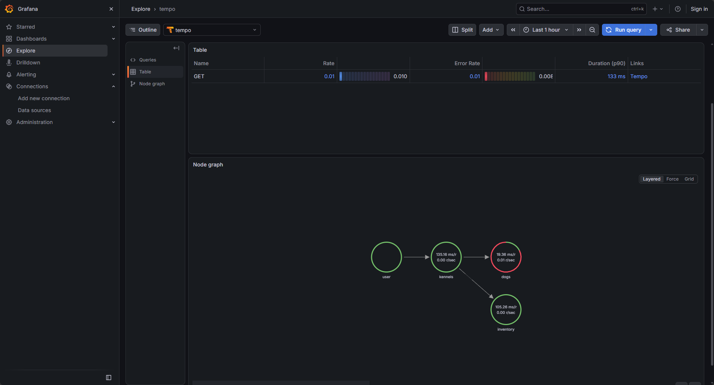
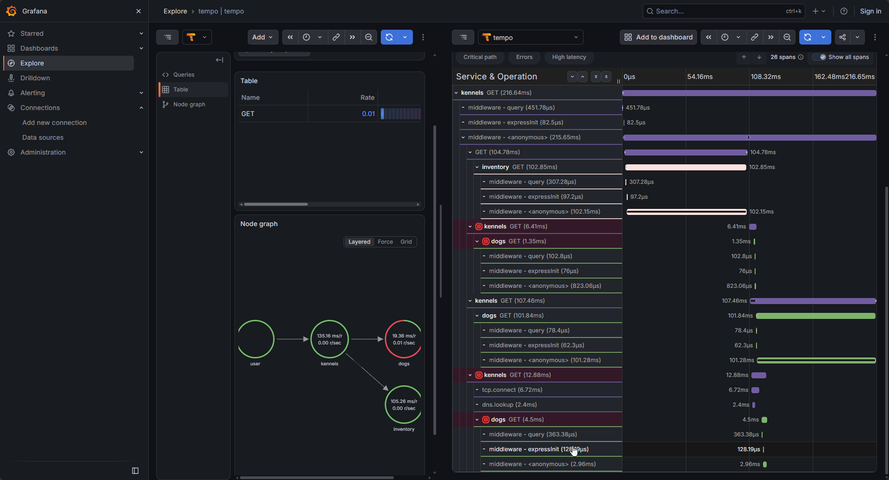
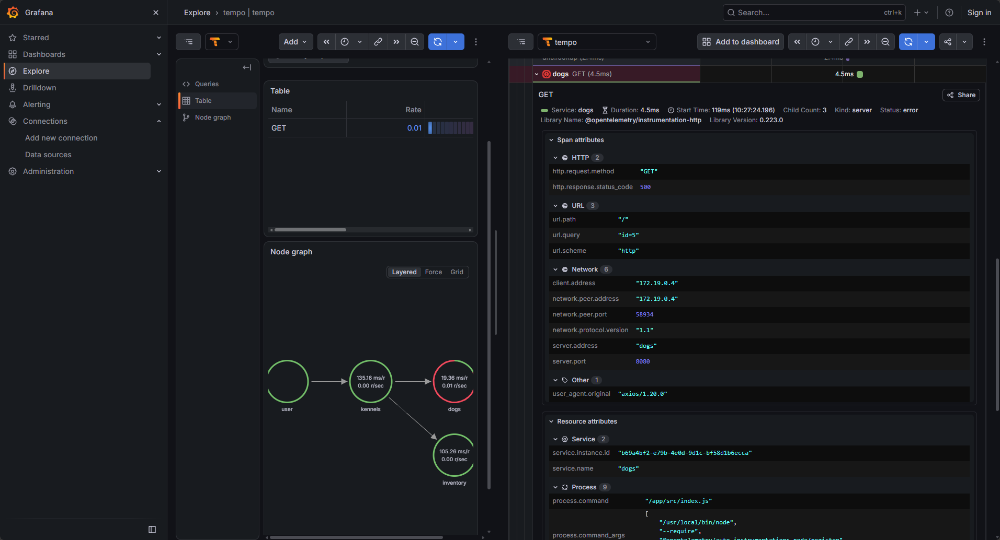
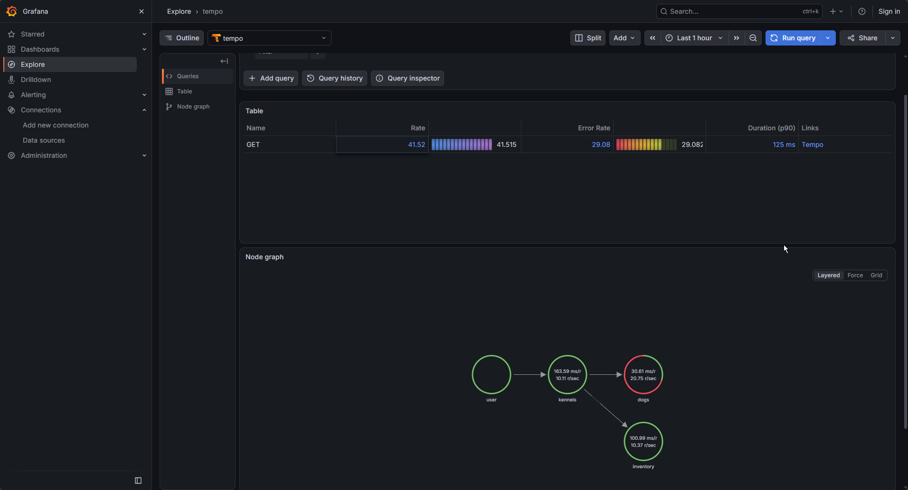
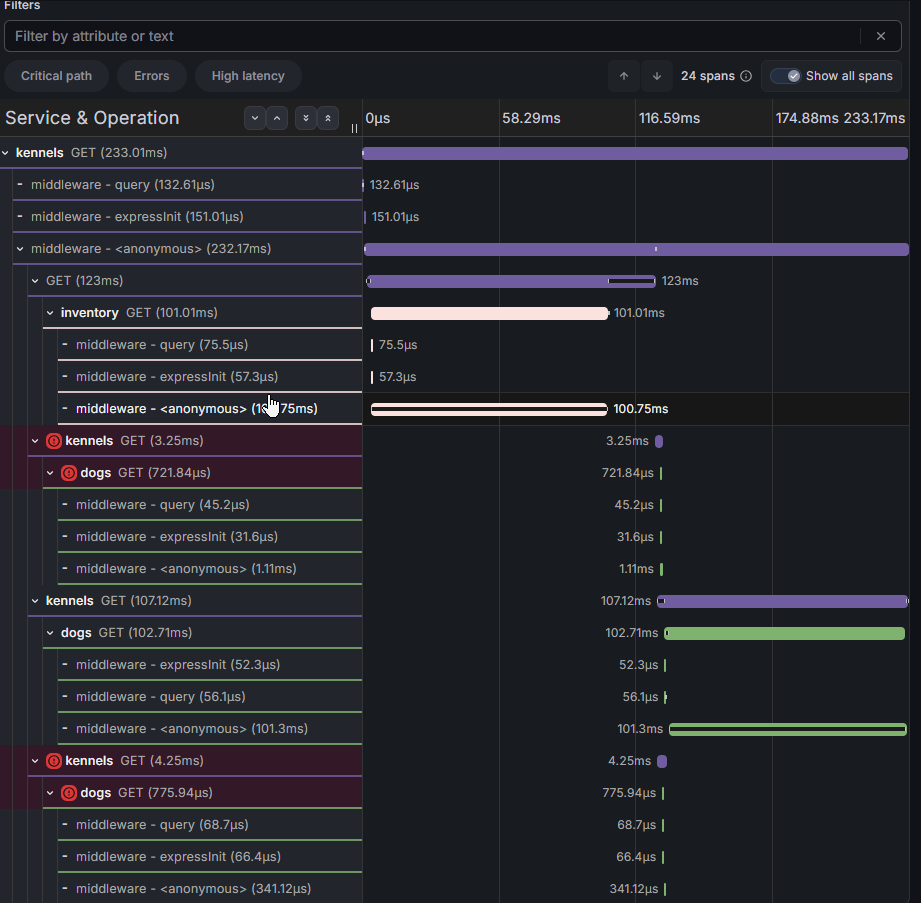
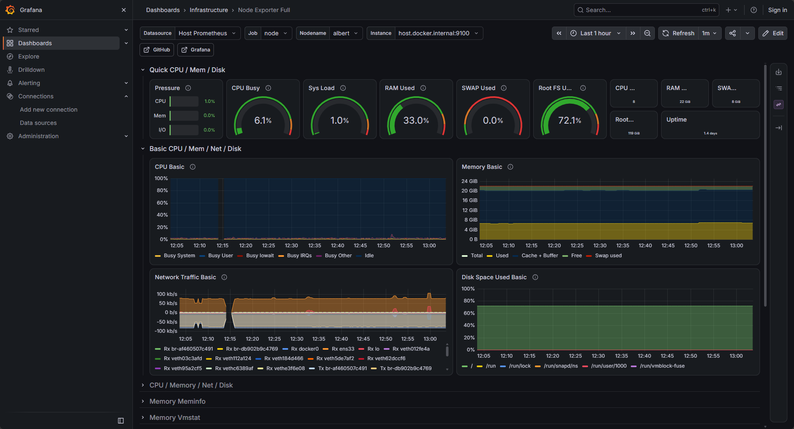
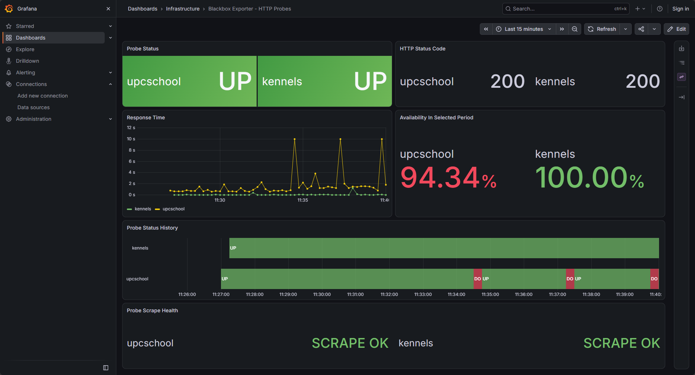
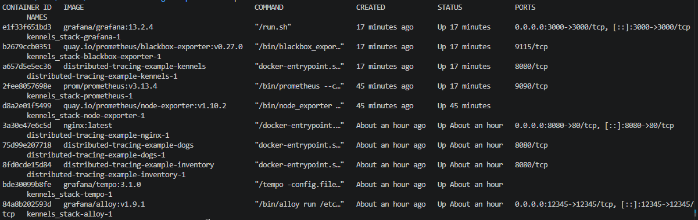

# Distributed Tracing Example

This repository contains the base code to implement Tracing observability with `OpenTelemetry`

Check the Grafana guide for more info:
(https://grafana.com/blog/2021/09/23/intro-to-distributed-tracing-with-tempo-opentelemetry-and-grafana-cloud/)

## Traza de error 

### 3.3 - Observa las trazas que se generan en Tempo. ¿Cuál es el ratio de fallos que nos estamos encontrando en el microservicio dogs? ¿Cuántas peticiones por segundo estamos generando con K6? ¿Cuál es el cuello de botella de la aplicación?

El error rate es de 29.08 (siendo el ratio 41.52)

Se estan generando aproximadamente 30 iteraciones por segundo

Aparte del problema de errores. La traza muestra que middleware-anonymous dura unos 232 ms porque engloba llamadas a /inventory y /dogs de unos 100 ms cada una

## Reto 1

## Reto 2

La indisponibilidad que aparece en UPCSchool es controlada. Se ha provocado deshabilitando el internet desde la máquina host.

## Full stack:
